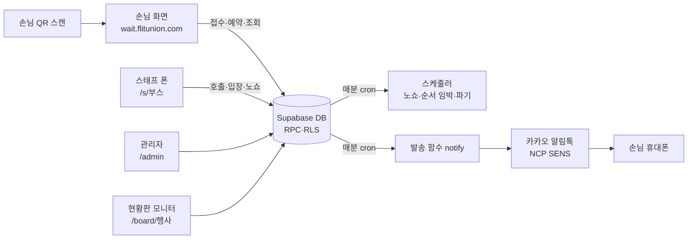

# FLIT WAIT 시스템 매뉴얼

행사 체험부스 **대기표·사전 예약·알림톡** 시스템의 전체 안내서. 운영 책임자와 스태프 리더가 읽는 문서입니다.
2026-10-24 성남테크아트페스티벌 2일차 운영 중 작성. 코드 구조는 `README.md`, 현장 장애는 `docs/장애대응_런북.md`, 서버 운영 상세는 `OPERATIONS.md` 가 정본이며 이 문서는 그 셋을 한 흐름으로 묶은 것입니다.

---

## 1. 시스템 한눈에



| 구성요소 | 위치 | 역할 |
|---|---|---|
| 화면 | Vercel `flit-wait` → `wait.flitunion.com` | 손님·스태프·관리자·현황판 (정적 웹앱, main 푸시 = 자동 배포 약 1분) |
| 공개 읽기 API | Vercel 엣지 `/api/public` | 목록·부스·현황판 조회를 5초 캐시(+15초 묵은 값 허용)로 묶어 DB 를 보호 |
| DB·API | Supabase `flit-wait` (서울) | Postgres + RPC. 손님·스태프는 테이블을 직접 읽지 않고 함수만 호출 |
| 스케줄러 | Supabase pg_cron 매분 | 순서 임박 알림 적재 · 호출 5분 뒤 노쇼 · 회차 시작 10분 뒤 노쇼 · 개인정보 파기 |
| 발송 | Edge Function `notify` 매분 | 알림톡 발송, 실패 시 SMS(부스 설정으로 끄기 가능), 테스트 번호대 차단 |
| 자정 작업 | pg_cron 00:05 KST | "오늘 마감" 자동 해제 |
| 헬스 체크 | `/api/health` | cron·발송 큐·열린 행사·부스 상태를 JSON 한 장으로 |
| 소스 | GitHub `leearo9528-creator/flit-wait` | DB 변경은 `supabase/migrations/NNNN_*.sql` 파일이 정본 |

비용: 평소 0원(Vercel Hobby + Supabase Free). 행사 주간만 Supabase Pro + Small 컴퓨트 약 $40, 알림톡 건당 약 8원. 행사 1건(3일, 수천 건) 원가 약 10만 원.

### 화면 주소

| 주소 | 누가 | 용도 |
|---|---|---|
| `/e/{행사}` | 손님 | 통합 QR. 부스 목록, 대기 팀 수·잔여석, 존 필터 |
| `/q/{부스}` | 손님 | 대기표 접수 |
| `/r/{부스}` | 손님 | 회차 사전 예약 |
| `/t/{토큰}` | 손님 | 내 대기표·예약 (알림톡 버튼이 여기로 연결), 취소 |
| `/e/{행사}/my` | 손님 | 이름+번호로 내 대기·예약 찾기 (폰을 바꿨거나 알림을 못 받았을 때) |
| `/s/{부스}` | 스태프 | PIN 4자리 → 보드 |
| `/board/{행사}` | 안내부스 모니터 | 현황판 (3초 갱신) |
| `/admin` | 관리자 | 접속 코드 로그인 |
| `/api/health` | 운영자 | 상태 JSON. `"ok": true` 면 정상, `503` 이면 `problems` 가 곧 증상 |

성남 2026: 행사 `seongnam-2026`, 부스 `tech-1` `tech-2` `tech-3` (대기표) · `cooking-tortilla` `cooking-parfait` (예약 전용).

---

## 2. 화면별 안내

### 2-1. 손님

**목록** `/e/{행사}` — 부스마다 상태 뱃지와 한 줄 현황이 붙습니다.

| 뱃지 | 뜻 | 한 줄 현황 |
|---|---|---|
| 접수 중 | 대기표를 받는 중 | 대기손님 현황 N팀 · 예상 약 N분 / 60분 이상 |
| 접수 오픈 예정 | 접수 시간대 전 (예: 12:00 오픈) | 대기 접수 12:00~ |
| 오늘 접수 마감 | 접수 마감 시각 지남 또는 스태프 마감 | 오늘 접수 마감 |
| 일시 중단 | 스태프가 잠시 멈춤 | (흐리게) |
| 예약 중 | 회차 예약 가능 | 오늘 잔여 N석 |
| 예약 오픈 예정 | 그날 회차 오픈 시각 전 (예: 매일 12:00) | 예약 오픈 10. 24. (토) 12:00 |
| 예약 마감 | 오늘 회차 전부 매진 | 오늘 예약 마감 |
| 시작 전 | 행사 시작 시각 전 (대기표 부스) | |

**대기 접수** `/q/{부스}` — 이름·휴대폰(자동 하이픈)·인원(최대 4, 설정)·개인정보 동의. 동의 전엔 버튼이 눌리지 않습니다. 접수 시간대 전에는 폼 위에 반투명 회색 박스로 "접수 예정 · 대기 접수 : 12:00~ · (안내 한 줄)". 일시 중단이면 "대기 인원이 많아 접수가 일시 중단 되었습니다. 원활한 운영을 위해 최선을 다하겠습니다." 같은 번호로 같은 부스에 두 번은 안 됩니다(다른 부스는 됨).

**사전 예약** `/r/{부스}` — 날짜 탭 → 회차 버튼(잔여석·매진·오픈 전·예약 마감) → 인원(잔여석 한도) → 정보 입력. 회차 시작 15분 전(설정)부터 예약 마감, 손님 취소는 시작 30분 전까지.

**내 대기표** `/t/{토큰}` — 대기번호, 내 앞 대기 N팀(호출됐지만 아직 입장 안 한 팀 포함), 예상 시간. 호출되면 "지금 입장해 주세요" + 남은 시간 카운트다운 + 진동·소리. 입장하면 "입장 완료". 노쇼면 "순서가 지나갔어요 · 다시 접수하기". 갱신 주기: 순서 임박·호출 중 6초, 앞 10팀 이내 15초, 그 외 30초, 끝난 티켓 60초. 백그라운드 탭에서는 멈췄다가 다시 보면 즉시 갱신.

**내 대기·예약 찾기** `/e/{행사}/my` — 접수할 때 쓴 이름과 번호로 티켓 목록을 찾아 들어갑니다.

### 2-2. 스태프

**로그인** `/s/{부스}` — 숫자 패드로 PIN 4자리. 4번째 숫자를 누르면 바로 들어갑니다. 세션은 로그아웃 전까지 유지되고, 같은 PIN 으로 여러 폰이 동시에 들어와도 됩니다. **PIN 을 바꾸면 모든 폰이 로그인 화면으로 튕기므로** 행사 중에는 바꾸지 않습니다.

**보드 상단** — 상태 뱃지와 버튼은 상태에 따라 바뀝니다.

| 뱃지 | 보이는 버튼 | 뜻 |
|---|---|---|
| 접수 오픈 예정 12:00 | `접수 오픈` | 예정 시각 전에 지금 바로 열기. 그날 하루는 시간 설정보다 우선 |
| 접수 중 · 수동 오픈 | `오픈 취소` `일시중단` `접수 마감` | 오픈 취소 = 예정 시각대로 되돌림, 접수된 손님 유지 |
| 접수 중 | `일시중단` `접수 마감` | |
| 접수 일시중단 | `접수 재개` | 새 접수만 막힘. 호출·입장·노쇼는 계속 가능 |
| 오늘 접수 마감 | `접수 오픈` | 자정 00:05 자동 해제. 되돌리려면 `접수 오픈` |
| (예약 부스) 예약 오픈 예정 12:00 | `예약 오픈` | 12:00 전에 그날 회차 열기 |
| (예약 부스) 예약 중 | `예약 마감` | 예약 전용 부스는 마감이 예약에도 적용 |

`큰 글씨` 는 숫자를 키우는 보기 옵션, `로그아웃` 은 이 폰의 세션만 끊습니다.

**대기열 탭**
- `다음 호출 → N번 이름` 한 번에 맨 앞 팀 호출. 알림톡 발송, 손님 화면 "지금 입장해 주세요". **한 번에 2~3팀까지만.** 20팀을 몰아 부르면 알림은 가지만 부스 앞이 몰리고 5분 뒤 전부 노쇼가 됩니다.
- 호출됨 카드: `입장` / `노쇼` / `재호출`(알림 재발송, 5분 다시 시작). 5분(설정) 지나면 자동 노쇼.
- 대기 카드: `호출`(순서 바꿔 부를 때) / `삭제`(노쇼 처리).
- `대리 접수`: 폰 없는 손님. 이름이나 특징만 적고, 알림이 안 가니 번호를 불러 줍니다. 버튼이 `입장`으로 바뀝니다.
- `오늘 처리 내역 ▼`: 입장·노쇼·취소 목록. `지금 입장`(늦게 온 노쇼 손님), `호출로 복구`(입장을 잘못 누른 경우, 알림 없이 호출 카드로), `대기로 복구`(노쇼를 잘못 누른 경우, 원래 순서 맨 앞). 필터·검색 가능.
- 서버가 막는 것: 입장한 손님에게 노쇼·호출 → "먼저 되돌리기를 눌러 주세요". 입장 두 번 → 알림 한 번만. 폰 2대가 같은 손님을 동시에 눌러도 꼬이지 않습니다.
- 폰 간 화면 동기화는 폴링이라 **최대 8초** 걸립니다.

**회차 탭** (예약·혼합 부스)
- 날짜 탭(오늘 표시) → 회차 카드(예약 N/정원, 체크인 N, 진행 중 뱃지). 시작 90분 이내 회차는 자동으로 펼쳐집니다.
- 예약 손님: `체크인` / `노쇼`. 노쇼 손님이 오면 `체크인`(정원 남은 경우) 또는 `복구`. 취소된 예약은 `예약 복구`.
- `+ 현장 손님 추가 (잔여 N석)`: 빈 자리를 현장에서 채울 때. 시작 15분 전부터는 추가 즉시 입장 상태. 정원이 차면 버튼이 사라집니다.

### 2-3. 관리자 `/admin`

접속 코드로 로그인(이메일 계정 없음). 전체 관리자 코드는 `admin_codes` 테이블, 행사 담당자 코드는 행사 > 접속 코드 탭에서 발급.

| 탭 | 내용 |
|---|---|
| 부스 | 부스 카드(오늘 대기·호출·완료·노쇼), 손님·스태프 링크, `설정` |
| 통계 | 행사 전체 누적(부스별 접수·입장·노쇼·평균 대기, 시간대별, 알림 상태), CSV |
| 행사 설정 | 이름·일시·상태(draft/open/closed)·공지·개인정보 문구·보존기간·대표 이미지·즉시 파기 |
| 접속 코드 | 담당자 코드 발급·비활성화 |
| 발송 로그 | 알림 건별 상태(대기·발송·실패·건너뜀)와 오류 |

부스 설정 화면: 기본 정보(이름·위치·존·카테고리·모드·정렬·소개·사진·아이콘) / 운영 설정(아래 4절) / 스태프 PIN·QR(PIN 재설정, 손님·예약·스태프 QR 다운로드) / 회차(날짜·시작 시각들·길이·정원 일괄 생성, 회차 취소).

### 2-4. 현황판 `/board/{행사}`

안내부스 모니터용 다크 화면. 3초마다 DB 에서 직접 갱신. 대기표 부스: 지금 호출 번호(최근 4개), 대기 팀, 마지막 입장 번호, 예상 대기(60분 넘으면 "60분 이상"). 예약 부스: 진행 중 회차 뱃지, 다음 회차 시각, 잔여석/매진. 일시 중단·오늘 마감은 뱃지로.

---

## 3. 행사 세팅 절차

| 시점 | 할 일 |
|---|---|
| D-14 | 관리자 > 새 행사(이름·slug·시작/종료 시각 KST). 상태 `draft` |
| D-14 | 부스 추가. 모드: `queue` 대기표 · `slot` 예약 전용 · `hybrid` 예약 + 노쇼 자리 현장 대기. 회차제 정원형이면 `slot` |
| D-10 | 부스 설정(4절), 사진·아이콘·소개·위치, 존·카테고리 |
| D-10 | 예약 부스 회차 일괄 생성 (날짜마다 반복) |
| D-7 | Supabase Pro + Small 컴퓨트 켜기 (재시작 1~2분, 행사 전날 이전에). NCP 알림톡 잔액·일 한도 확인 |
| D-7 | PIN 설정 → 스태프에게 전달. QR PNG 다운로드 → 사인물 제작(통합 1장 + 부스별) |
| D-5 | 사전 점검: 테스트 행사(`test`)에서 접수·호출·예약 한 바퀴, 운영팀 번호로 알림톡 실수신, 부하 테스트(테스트 번호대만) |
| D-1 | 행사 상태 `open`. 스태프 폰 PIN 로그인 리허설. 현황판 모니터 전체화면 |
| D-day | 관리자 부스 카드 대기 0 확인. 접수 오픈·예약 오픈은 설정 시각에 자동 |

**접수 시작 시각과 운영 시작 시각을 같게 두는 것을 권합니다.** 성남은 접수 12:00·운영 14:00 으로 2시간 차를 뒀더니 운영 시작 시점에 부스당 50~80팀이 쌓였고, 2~3시간 전에 줄 선 손님은 호출해도 오지 않아 노쇼가 절반을 넘었습니다. 미리 받고 싶다면 1시간 이내로.

---

## 4. 부스 설정값 사전

관리자 > 부스 > 운영 설정. 괄호는 성남 2026 값.

| 항목 | 뜻 | 기본 |
|---|---|---|
| 1건당 최대 인원 | 접수·예약 한 건의 인원 상한 | 4 |
| 대기 접수 마감 (행사 종료 N분 전) | 마지막 날 이 시각부터 접수 거부 | 30 |
| 순서 임박 알림 (앞 N팀) | 접수 3분 뒤부터, 앞 팀이 N 이하면 알림톡 | 2 (테크 2~3) |
| 호출 후 유효시간 → 노쇼 | 호출 뒤 이 시간 안 오면 자동 노쇼 | 5 (테크 5~10) |
| 1팀당 소요 시간 → 예상 대기 | 예상 대기 = 대기 팀 수 × 이 값. 0 이면 자동 측정 | 0 (테크 7) |
| 사전 예약 마감 (회차 시작 N분 전) | 회차 예약 마감. 이후는 현장 추가만 | 60 (쿠킹 15) |
| 회차 시작 후 미체크인 노쇼 | 시작 N분 뒤 미도착 예약 자동 취소 | 10 |
| 손님 자체 취소 가능 (시작 N분 전까지) | 그 뒤엔 취소 버튼 숨김, 스태프에게 | 120 (쿠킹 30) |
| 사전 예약 오픈 일시 | 전체 회차 예약 시작 시각. 비우면 즉시 | 없음 |
| 일별 예약 오픈 시각 | 매일 이 시각에 그날 회차 오픈 (위와 둘 중 늦은 쪽) | 없음 (쿠킹 12:00) |
| 대기표 접수 오픈 시각 | 매일 이 시각부터 접수. 전엔 "접수 예정" | 없음 (테크 12:00) |
| 대기표 접수 마감 시각 | 매일 이 시각부터 "오늘 접수 마감" | 없음 (테크 20:00) |
| 접수 오픈 전 안내 한 줄 | "대기 접수 : 12:00~" 아래 문장 | 없음 (테크 "시작 2시간 전부터 접수 가능합니다.") |
| 리마인드 ① 전날 N시 / ② 시작 N분 전 | 예약 손님 리마인드 알림톡. 비우면 안 보냄 | 없음 (성남 제거) |
| 같은 번호 중복 접수 허용 | 켜면 한 번호로 같은 부스에 여러 건 | 끔 |
| 예약 노쇼 좌석을 현장 대기에 개방 | 혼합 부스에서 빈 자리를 현장 대기 1순위에게 자동 호출 | 켬 |
| 알림톡 실패 시 SMS 대체 발송 | 카카오 미가입·차단 번호에 문자. 건당 약 9원 | 끔 (성남 결정) |

스태프가 보드에서 누른 `접수 오픈`은 설정값과 별개로 그날만 적용되는 임시값입니다(`open_override_date`). `오픈 취소`가 지우고, 자정이 지나면 자연히 무효.

---

## 5. 당일 운영

### 하루 흐름 (성남 기준)

| 시각 | 자동으로 일어나는 일 | 스태프가 하는 일 |
|---|---|---|
| 00:05 | 어제 "오늘 마감" 자동 해제 | |
| 10:00 | 행사 시작 (이 전엔 접수 불가) | 폰 PIN 로그인, 보드 켜기 |
| 12:00 | 테크 접수 오픈, 쿠킹 그날 회차 예약 오픈 | 일찍 열려면 `접수 오픈`/`예약 오픈` |
| 운영 중 | 매분: 순서 임박 알림, 호출 5분 뒤 노쇼, 회차 10분 뒤 노쇼 | 2~3팀씩 호출, 입장, 대리 접수, 회차 체크인·현장 추가 |
| 줄이 길 때 | | `일시중단` (새 접수만 끊고 줄은 소화) |
| 20:00 | 테크 "오늘 접수 마감" (마지막 날은 종료 30분 전 규칙이 먼저) | 더 안 받으면 `접수 마감` |

### 호출·줄 관리 요령

- **대기 60팀을 넘으면 일시중단.** 1팀 7분이면 60팀 = 7시간입니다. 중단해도 호출·입장은 계속되고, 줄이 줄면 `접수 재개`.
- 한 번에 2~3팀. 호출 유효 5분 안에 못 오면 노쇼가 되고 다음 팀이 당겨집니다.
- 노쇼 손님이 늦게 오면 처리 내역에서 `지금 입장`. 자리를 빼앗지 않도록 다음 팀 입장 뒤에.
- 폰 없는 손님은 `대리 접수` 후 번호를 육성으로.
- 예약 부스 빈 자리는 `현장 손님 추가`. 정원 초과는 서버가 막습니다.
- `접수 마감`은 그날 끝입니다. 잘못 눌렀으면 `접수 오픈`으로 되돌립니다.
- 손님에게 "예상 대기"는 60분 넘으면 숫자 없이 "60분 이상"으로만 보입니다.

### 손님 안내 문구 (스태프가 손님에게)

| 손님 말 | 답 |
|---|---|
| 알림이 안 와요 | 대기표 화면(알림톡 버튼 또는 `내 대기·예약` 에서 이름+번호)이 자동 갱신됩니다. 재호출로 다시 보내 드립니다 |
| 번호가 안 바뀌어요 | 15~30초마다 갱신되고, 앞 팀이 호출됐어도 입장 전까지는 앞 팀으로 셉니다 |
| 취소 버튼이 없어요 | 호출된 뒤거나 예약 취소 마감(시작 30분 전)이 지난 것. 스태프가 처리 |
| 같은 번호로 또 안 돼요 | 같은 부스 1건 규칙. 기존 건 처리 후 재접수. 다른 부스는 됩니다 |
| 쿠킹 다 매진인데요 | 오늘 회차는 매진. 노쇼 자리는 부스에서 현장 안내. 내일 회차는 내일 12:00 오픈 |

---

## 6. 알림톡

| 코드 | 언제 | 성남 |
|---|---|---|
| Q01 대기 접수 완료 | 접수 직후 | 켬 |
| Q02 곧 입장 순서 | 접수 3분 뒤부터, 앞 N팀 이하일 때 1회 | 켬 |
| Q03 지금 입장해 주세요 | 호출·재호출 | 켬 |
| Q04 입장 확인 | 입장 처리 | **끔** |
| Q05 대기 종료 (노쇼) | 호출 유효시간 경과 또는 스태프 노쇼 | 켬 |
| Q06 대기 취소 | 손님 취소 | 켬 |
| R01 예약 확정 | 예약 직후 | 켬 |
| R02 예약 리마인드 | 설정 시각 | 켬 (성남은 리마인드 설정 제거로 미발송) |
| R03 예약 취소 | 손님 취소 | 켬 |
| R04 미도착 취소 | 회차 시작 10분 뒤 | 켬 |
| R05 체크인 완료 | 체크인 | **끔** |

- 발송은 매분 배치. 호출은 즉시 발송을 추가로 깨웁니다. 평균 지연 2초, 최대 1분.
- **테스트 번호대 `010-00xx-xxxx` 는 절대 실발송하지 않습니다**(발송 로그에 `skipped TEST_NUMBER`). 테스트는 반드시 이 번호대 + `test` 행사로. 2026-10-18 에 임의 번호 208건 오발송 사고가 있었습니다.
- 12자리 등 잘못된 번호도 접수는 되지만 알림은 실패합니다. 행사 후 11자리 검증 추가 예정.
- 템플릿 본문·버튼을 NCP 콘솔에서 고치면 DB `templates` 도 글자 단위로 같게 맞춰야 합니다.
- 일 한도 10,000건(승인됨). 잔액은 NCP 콘솔.
- 로그: 관리자 > 발송 로그. 실패 원인 표는 런북 §3-2.

---

## 7. 모니터링

- **헬스** `https://wait.flitunion.com/api/health` — 폰에서도 열립니다. 보는 것: cron 최근 실행·실패, 발송 큐(멈춤·지연·실패), 발송 함수 응답, 열린 행사, 부스 일시중단, 오늘 티켓. `problems` 가 비어 있으면 정상.
- **관리자 > 부스 카드**: 오늘 기준 대기·호출·완료·노쇼. **통계 탭**은 행사 전체 누적.
- **현황판**: 운영 시작 뒤 "지금 호출"이 비어 있는 부스가 있으면 그 스태프가 보드를 안 쓰고 있는 것입니다. 성남 2일차에 한 부스가 3시간 반 동안 호출 0건이었습니다.
- **자동 점검 루틴**: 행사 기간 매일 08:30·12:30 KST 에 헬스·손님 목록·화면 3개를 점검해 보고를 남깁니다(claude.ai 루틴). 행사 후 끄기.
- **용량**: Small 컴퓨트 기준 동시 대기표 폴링 약 2,000명까지 응답 0.3~0.7초. 3,000명이면 3초대. 목록·현황판은 캐시라 접속자 수와 무관. 더 필요하면 Compute Medium(재시작 1~2분, 손님 없는 시간에).
- **화면 갱신 지연 기준값**: 손님 목록·부스 화면 보통 15~20초, 최악 35초(캐시). 손님 대기표 6~30초. 스태프 폰 간 최대 8초. 현황판 3초.

---

## 8. 장애 대응 요약

상세는 `docs/장애대응_런북.md`. 원칙: 손님 앞에서는 종이·육성으로 먼저, 그다음 시스템, 데이터는 지우지 말고 상태만 바꾼다.

| 증상 | 1분 판단 | 조치 |
|---|---|---|
| 손님 화면 전체 안 열림 | Vercel 배포 상태 | 이전 배포 Promote to Production |
| 화면은 뜨는데 데이터 없음 | Supabase 프로젝트 상태 | Paused → Restore / Restarting → 대기 |
| 알림이 전부 안 감 | 헬스 `notify.pending_overdue` | 런북 §3-1 (cron·secret·함수 로그) |
| 특정 알림 실패 | 발송 로그 오류 문구 | 런북 §3-2 (템플릿 불일치·한도·잔액) |
| 스태프 화면 안 열림 | 폰 통신 | 다른 폰 같은 PIN. 안 되면 종이 번호표 + 육성, 복구 후 대리 접수로 기록 |
| 스태프가 잘못 눌렀다 | 처리 내역 | 호출로 복구 / 대기로 복구 / 지금 입장 / 오픈 취소 |
| 오발송 의심 | 발송 로그 | 행사 `closed` → 대기 알림 `skipped` → 원인 파악 → `open` |
| 느림 | Supabase Reports > CPU | 60% 넘으면 Compute 한 단계 상향 |

플랜 B: 스태프 화면이 죽어도 알림톡 cron 은 독립적으로 돌고, 손님 화면이 죽어도 스태프 보드는 돕니다. 둘 다 죽으면 종이 번호표.

---

## 9. 행사 후

1. 관리자 > 통계 > CSV 내보내기 (접수·입장·노쇼율·평균 대기).
2. 행사 상태 `closed`.
3. 개인정보는 보존기간(종료 후 7일) 지나면 자동 파기. 즉시 파기는 행사 설정 > 즉시 파기.
4. Supabase Compute Small → Micro, Pro → Free. 자동 점검 루틴 끄기.
5. `test` 행사는 두되 테스트 데이터 정리.
6. 다음 행사는 3절부터. 템플릿·채널·함수는 재사용.

---

## 10. 성남 2026 에서 배운 것

**운영**
- 접수 시작(12:00)과 운영 시작(14:00)의 2시간 차가 대기 폭증과 노쇼 과반의 원인. 다음부터는 같은 시각으로.
- 한 부스가 운영 시작 후 1시간 반 동안 보드를 안 썼다. 현황판의 "지금 호출" 공란이 신호.
- 몰아서 호출(한 번에 23팀)하면 전부 노쇼. 2~3팀씩.
- 대기 60팀 넘으면 일시중단이 안전선.
- 예상 대기는 측정값보다 "1팀 7분" 같은 고정값이 현장과 맞았다. 60분 넘으면 숫자를 보여주지 않는다.
- 스태프 PIN 은 부스별 고유값보다 하나로 통일하는 편이 현장에서 덜 막혔다.

**시스템** (전부 반영 완료)
- 접수 시간대(일별 오픈·마감)와 스태프 오픈/마감/오픈 취소 버튼.
- 행사 시작 전 잠금을 스태프 오픈이 풀도록. NULL 비교 버그로 잠금이 9시간 무력화됐던 것을 수정.
- 현황판: 진행 중 회차와 다음 회차 분리, 3초 직접 갱신, 예상 대기 60분 이상 표기.
- 관리자 부스 카드는 오늘 기준으로.
- 손님 화면 캐시 묵은 값 60초 → 15초.
- 손님 문구: "일시 중단", "접수 예정", "예약 마감".
- 오류 문구 정리 함수가 "PIN이 올바르지 않습니다"의 PIN 을 잘라내던 버그.
- 테스트 스크립트 교훈: 막혀야 하는 케이스부터 돌린다. 테스트 번호는 11자리.

**남은 과제**
- 전화번호 11자리 검증, 대기표 폴링 함수 경량화, 알림 테스트 모드 스위치, 스태프 확인창 인앱 모달, 관리자 화면 자동 점검.

---

## 11. 데이터·개인정보

- 수집: 이름, 휴대폰, 인원. 목적: 대기·예약 안내 알림. 보존: 행사 종료 후 7일(행사 설정) 뒤 이름 `삭제됨`·번호 NULL 로 파기.
- 손님·스태프 화면은 DB 테이블을 직접 읽지 못하고 함수만 호출합니다. 스태프 화면에는 전화번호 뒤 4자리만 보입니다.
- 티켓은 삭제하지 않고 상태만 바꿉니다(`waiting → called → checked_in / no_show / cancelled`). 복구가 항상 가능한 이유.
- 테스트는 `test` 행사 + `010-00xx-xxxx` 번호대로만. 테스트 뒤 번호는 NULL 처리.

---

## 12. 변경 이력 (성남 주간)

| 날짜 | 내용 |
|---|---|
| 10/18 | 사전 점검: 서버 함수 시뮬레이션 43케이스, 알림 11종 실수신, 부하 526명. 부하테스트 오발송 208건 사고 → 테스트 번호대 차단 |
| 10/20 | 스태프 되돌리기(호출 카드 복귀), 스태프 매뉴얼, SMS 대체 끔 |
| 10/22 | 행사 시작 전 접수 잠금 (리플렛 QR 선스캔 대응) |
| 10/23 새벽 | PIN 통일, 접수 시간대·스태프 오픈/마감(0030), 리마인드 제거, 안내 문구, 부하 3,000·2,000명, 알림 9종 실수신, 오픈 취소(0033) |
| 10/23 11시 | 스태프 오픈이 행사 시작 전 잠금도 해제(0031), NULL 비교 버그 수정(0032), 스태프·손님 UI 시뮬레이션 60여 케이스 |
| 10/24 | 현황판 진행 중 회차·예상 대기 추정(0034), 1팀 7분 설정(0035), 60분 이상 표기, 예약 마감 뱃지, 관리자 카드 오늘 기준, 일시 중단 문구, 현황판 3초, 캐시 15초 |

---

## 부록 A. 자주 쓰는 SQL (Supabase SQL Editor)

```sql
-- 상태 한 장
select health_summary();

-- 티켓 상태 되돌리기 (삭제 금지)
update tickets set status='waiting', called_at=null, checked_in_at=null where token='<토큰>';

-- 부스 설정 한 항목만
update booths set settings = settings || '{"call_valid_min": 7}'::jsonb where slug='tech-1';

-- 스태프 수동 오픈 흔적 지우기 (오픈 취소와 동일)
update booths set settings = settings - 'open_override_date' where slug='tech-1';

-- 회차 정원 늘리기 / 회차 닫기
update slots set capacity = 24 where id = '<slot uuid>';
update slots set status = 'closed' where id = '<slot uuid>';

-- 특정 손님에게 알림 다시 보내기 (Q01~Q06, R01~R05)
select enqueue_notification((select id from tickets where token='<토큰>'), 'Q03');

-- 행사 긴급 중단 / 재개
update events set status='closed' where slug='seongnam-2026';
update events set status='open'   where slug='seongnam-2026';
```

## 부록 B. 용어

| 용어 | 뜻 |
|---|---|
| 대기표(queue) | 번호를 받고 순서를 기다리는 방식. 호출 → 입장 |
| 회차(slot) | 시작 시각과 정원이 정해진 예약 단위. 체크인 |
| 혼합(hybrid) | 예약 + 노쇼 자리를 현장 대기줄에 자동 이관 |
| 호출 유효시간 | 호출 뒤 자동 노쇼까지의 시간 |
| 일시중단 / 오늘 마감 | 새 접수만 잠시 막음 / 그날 끝(자정 해제) |
| 수동 오픈 | 스태프가 예정 시각 전에 연 상태. 오픈 취소로 되돌림 |
| 테스트 번호대 | `010-00xx-xxxx`. 알림이 절대 나가지 않는 번호 |
